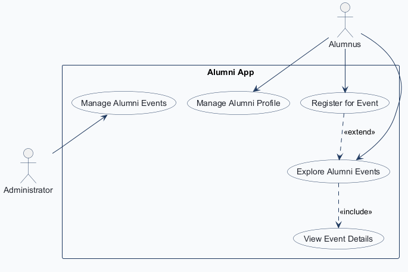
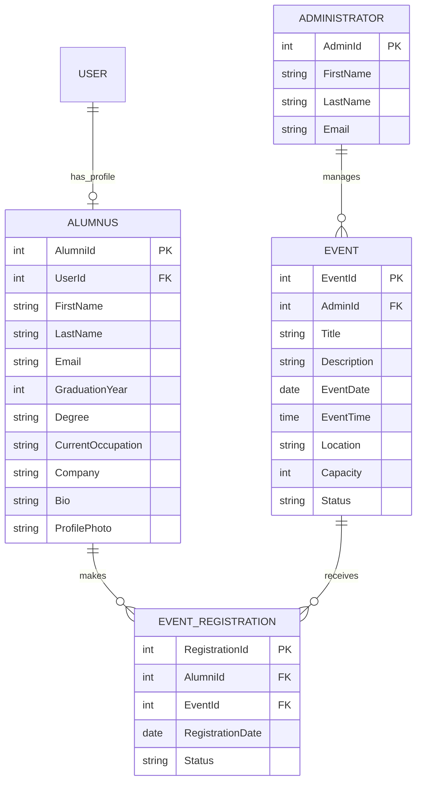
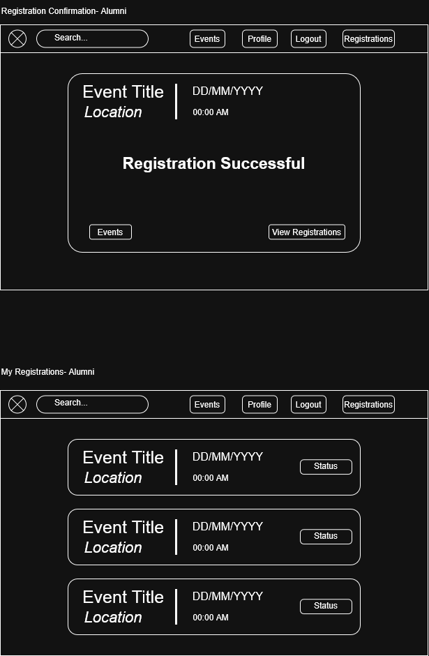
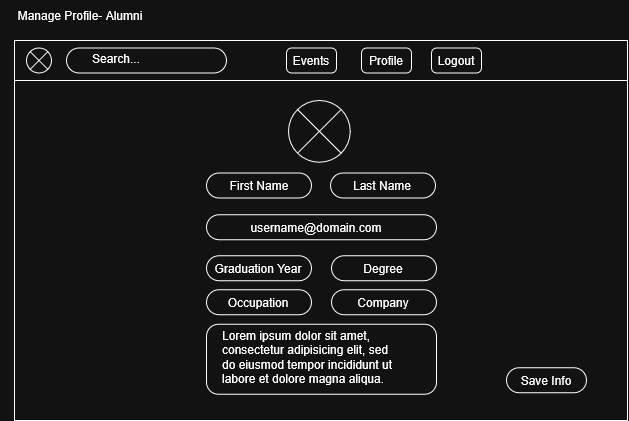
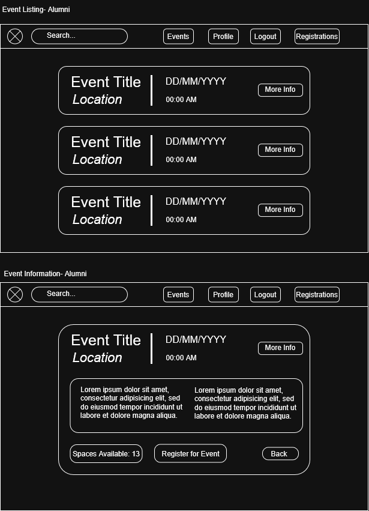
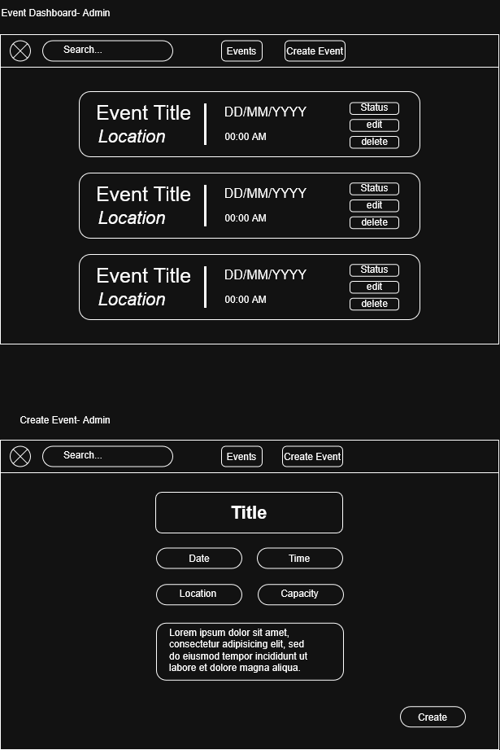

# COMP 3613 Assignment 1

Draft this file with the Guide. **Update it after every phase milestone** before you pause. The use-case diagram is a UML PNG at `docs/diagrams/use-case.png`, linked from this file as `diagrams/use-case.png` (path relative to `docs/report.md`). The model diagram is Mermaid. **Embed wireframe images** as `wireframes/<file>` (files live in `docs/wireframes/`).

Do not put your student ID in this file if you will commit it. The PDF cover adds your name and ID at export time.

## Assigned project
Alumni App — a CRM-style platform for the department / faculty to stay connected with graduates.

## Three workflows

### 1. Manage Alumni Profile (Alumnus)

### 2. Explore and Register for Alumni Events (Alumnus)

### 3. Manage Alumni Events (Administrator)

## Use case diagram

The alumnus explores events and views event details; registering is an optional extension of event exploration. Administrators manage events separately; event exploration is alumnus-only.

## Model diagram

First draft. `EventRegistration` links alumni and events. Each event has one managing administrator; `AdminId` was added to `Event` to represent that relationship. Registrations are blocked when an event reaches capacity. Phase 4 revision: added `Alumnus.ProfilePhoto` for the profile image/avatar shown in `registration.png`. Event spaces available are derived from capacity and registrations; no separate stored field is needed. Update this section in Phase 5 if polish revises the model, and note what changed.

## Wireframes

### Manage Alumni Profile

### Explore Alumni Events and View Event Details

### Register for Event

### Manage Alumni Events

Admin editing reuses the create-event interface with the selected event's values. Deleting an event requires confirmation.

<!-- student-build:wireframe-coverage
use_case: Manage Alumni Profile
image: docs/wireframes/registration.png
covered: yes
-->

<!-- student-build:wireframe-coverage
use_case: Explore Alumni Events
image: docs/wireframes/manage-page.png
covered: yes
-->

<!-- student-build:wireframe-coverage
use_case: View Event Details
image: docs/wireframes/manage-page.png
covered: yes
-->

<!-- student-build:wireframe-coverage
use_case: Register for Event
image: docs/wireframes/manage-events.png
covered: yes
-->

<!-- student-build:wireframe-coverage
use_case: Manage Alumni Events
image: docs/wireframes/manage-events-admin.png
covered: yes
-->

## Theming

**Brand:** Alumni Connect (text wordmark; no official university logo).

- **Colors:** deep navy `#142B4A`, white `#FFFFFF`, and gold `#D4AF37`; navy for brand/navigation, white page surfaces, gold for primary actions and highlights.
- **Type:** clean modern sans-serif with bold headings and readable body text.
- **Tone:** professional, welcoming, trustworthy, and community-focused.
- **Applied:** shared CSS tokens in `app/static/css/app.css`; public landing, login, register, and authenticated navigation now use Alumni Connect branding and the navy/gold palette. The design uses a system sans-serif stack, white surfaces, navy headings/navigation, and gold primary actions.
- **Starter UI:** retained auth, `/config`, and authenticated shells while replacing generic landing copy; workflow screens replace their respective placeholders incrementally.

## Implementation notes

One named workflow at a time. Include verify notes and polish / model revisions (Phase 5). Do not treat the first build as final.

### Manage Alumni Profile

Profile records are linked one-to-one to the existing FastStarter account using `UserId` (the student selected this over matching by email). `ProfilePhoto` will store an image URL (student selection).

<!-- student-build:code-check
workflow: Manage Alumni Profile
form: choice
layer: model
architecture_ok: yes
implement_confidence: 0.90
passed: yes
note: Student chose a UserId link to connect each alumni profile to its signed-in account.
-->

<!-- student-build:code-check
workflow: Manage Alumni Profile
form: choice
layer: model
architecture_ok: yes
implement_confidence: 0.91
passed: yes
note: Student chose to store the profile photo as a URL.
-->

<!-- student-build:code-check
workflow: Manage Alumni Profile
form: snippet
layer: model
architecture_ok: yes
implement_confidence: 0.93
passed: yes
note: Student added unique indexed UserId foreign key to user.id in the Alumnus SQLModel.
-->

<!-- student-build:code-check
workflow: Manage Alumni Profile
form: snippet
layer: router
architecture_ok: yes
implement_confidence: 0.91
passed: yes
note: Student route binds profile fields and delegates saving to the service; service signature aligned to its keyword call.
-->

Profile editing has been implemented against the profile wireframe: the authenticated user can view or save their own profile fields and photo URL; admins are restricted from this alumnus-only page.

**Student verification:** The student created an account, created and edited the alumni profile, entered a profile-photo URL, navigated to other pages, reloaded, and returned to the profile; they reported that the profile information remained saved. After the navigation adjustment, they reported that the app started successfully, the Profile link was visible and opened the correct page, the unfinished Events and Registrations links were hidden, and the saved profile information and photo still appeared. No further mismatch was reported. The Guide did not independently run the app flow.

**Polish adjustment:** Removed the Events and Registrations navigation links until those workflows are implemented, avoiding links to routes that do not yet exist. The student confirmed the adjusted navigation; no outstanding navigation issue was reported.

### Explore and Register for Alumni Events

The alumnus event workflow follows the submitted wireframes: browse/search open events, view details, see remaining capacity, register once, and view registration status. Full events show “Full” and do not show the registration action, per the student's choice. Capacity and duplicate-registration checks are coordinated in the service; persistence is in the repository. The database prevents duplicate active registrations per alumnus/event while allowing a new registration after the previous one is cancelled.

A sample future “Alumni Networking Mixer” event is added by the existing seed command so this workflow can be exercised before the administrator event-management workflow is implemented. The event is owned by a seeded administrator record. Admin event management remains the next workflow after this one is verified.

**Implementation:** Added the event and registration SQLModel entities, repository operations, service-level capacity and duplicate checks, and thin routes for event browsing, details, registration, and My Registrations. The templates show event details, remaining capacity, a full-event state, registration confirmation, and registration status. The sample event can be added with `python manage.py seed` without dropping existing data. The existing SQLite database had an empty legacy `eventregistration` table with only `registration_id`; initialization now transactionally rebuilds only that exact empty legacy table to match the model, and refuses unexpected or populated table shapes. Cancelled registrations are excluded from active duplicate checks and capacity counts. The unique partial index was exercised in a rolled-back database transaction: a duplicate active registration was rejected, and a new active registration after cancellation was accepted.

**Database repair verification:** The registration table now has `registration_id`, `alumnus_id`, `event_id`, `registration_date`, and `status`, with foreign keys to `alumnus.alumni_id` and `event.event_id`. Existing table counts before and after the repair match: user 3, alumnus 1, event 1, and eventregistration 0; the constraint test rows were rolled back. `PRAGMA foreign_key_check(eventregistration)` passed. Pylance syntax checks and `git diff --check` passed.

**Events rendering fix and student verification:** The supplied `/events` traceback showed that the registration-table query completed; rendering then failed because `url_for()` was passed `query` and `event_id` as if they were path parameters. The event-detail and back-to-list links now append those values as query parameters. The student then ran the app and confirmed the event workflow worked: an intentionally unmatched search returned no results, a matching search returned the event, “More Info” opened the event, and registering showed it on My Registrations with status `Pending`.

<!-- student-build:code-check
workflow: Explore and Register for Alumni Events
form: choice
layer: other
architecture_ok: yes
implement_confidence: 0.91
passed: yes
note: Student chose to label full events and hide/disable event registration.
-->

<!-- student-build:code-check
workflow: Explore and Register for Alumni Events
form: snippet
layer: model
architecture_ok: yes
implement_confidence: 0.93
passed: yes
note: Student added the EventRegistration foreign keys and date/status fields; uniqueness was revised to allow re-registration after cancellation.
-->

<!-- student-build:code-check
workflow: Explore and Register for Alumni Events
form: snippet
layer: router
architecture_ok: yes
implement_confidence: 0.91
passed: yes
note: Student's event list/detail handler delegates data retrieval to the service and renders the template without persistence logic.
-->

The student reported successful verification of the Events workflow above. The Administrator Events workflow now has a dashboard for owned events, event creation, detail editing, status changes, and search.

### Manage Alumni Events

The `/admin` route redirects to the `/admin/events` dashboard. It lists only events belonging to the signed-in administrator, supports search, and provides a dedicated create form plus per-event edit and status controls. Event fields are title, description, date, time, location, and positive capacity. Create, detail edit, and status changes are delegated from thin routes to `AdminEventsService`; `EventRepository` owns all reads and writes.

The service resolves the administrator from the authenticated account's existing email mapping. It validates required title/location, ISO date/time, positive whole-number capacity, allowed statuses (`Open`, `Closed`, `Cancelled`), event existence, and event ownership before each update. Repository writes also scope updates by event ID and owner ID. Flash messages report successful changes and validation, ownership, missing-record, or save failures. Styling uses the established Alumni Connect navy, white, and gold tokens. No database initialization/reset was run, and the profile and alumni registration implementations were not changed.

**Automated checks performed:** An isolated in-memory SQLite service check passed event creation, administrator-scoped listing, detail edits, invalid title/date/capacity rejection, wrong-owner update rejection, invalid-status rejection, and allowed status persistence. It also confirmed alumni registration succeeds for Open events and is refused for both Closed and Cancelled events. `admin.html` parsed as a Jinja template. Pylance diagnostics reported no issues in the changed service, repository, or router, and no issues in the existing alumni registration service. Pylance Python syntax checks passed for the changed Python files, and `git diff --check` passed. A standalone Ruff executable/lint configuration was not available, so no separate Ruff run was performed.

**Manual UI testing:** Not performed by the Guide. The student should run `python manage.py run` and follow the manual test steps in the completion message, then report any mismatch for polish.

**Student manual verification and mismatch:** The student signed in as admin, created a new event, and changed the original test event to `Cancelled`. They then signed in as an alumnus: the cancelled event no longer appeared in the open-events list, but its existing registration still displayed `Pending`. This exposed the difference between event and registration lifecycle states.

**Student decision:** When an administrator cancels an event, automatically change its linked registrations to `Cancelled`. The repository now performs those registration updates and the event status update in the same transaction. Reopening an event does not reactivate prior cancelled registrations; the alumni registration flow continues to require an Open event.

**Automated follow-up check:** A focused service check against an isolated in-memory SQLite database passed: cancelling an event updates its existing Pending registration to Cancelled in the same repository transaction; a cancelled event rejects a new registration; reopening permits a new Pending registration without reactivating the prior Cancelled registration. Pylance diagnostics and Python syntax validation reported no issues for the changed repository, and `git diff --check` passed.

**Follow-up observation and clarification:** After reporting that the registration badges still said Pending, a read-only query of the configured local SQLite database found both linked events currently had status `Closed`, with their registrations at `Pending`. This is consistent with the prior choice to auto-cancel registrations only when an event is explicitly Cancelled. The student chose to keep registration status separate from event status and show both on My Registrations.

**UI adjustment:** My Registrations now labels the two values independently (for example, `Registration: Pending` and `Event: Closed`). Existing event-cancellation behavior remains: choosing `Cancelled` automatically changes linked non-cancelled registrations to `Cancelled` in the same repository transaction. Reopening the event does not reactivate those registrations.

**Automated follow-up check:** Passed. The updated Jinja registrations template was rendered using the real, read-only alumnus registrations from the configured local database; the output included both `Registration: Pending` and `Event: Closed`. Pylance diagnostics reported no issues for the event repository or alumni events service, Python syntax validation passed for the repository, and `git diff --check` passed. The database query was read-only.

**Manual UI follow-up:** The student subsequently confirmed that the website works with the separate registration/event status display and is ready to proceed. This is student-reported verification; the Guide did not independently exercise the browser flow.

**Phase 5 exit:** The student accepted the implemented workflows and status-display polish. Phase 5 is complete; proceed to Phase 6 deployment. Deployment has not started.

<!-- student-build:code-check
workflow: Manage Alumni Events
form: snippet
layer: model
architecture_ok: yes
implement_confidence: 0.90
passed: yes
note: Student added reciprocal Administrator.events and Event.administrator relationships with back_populates.
-->

<!-- student-build:code-check
workflow: Manage Alumni Events
form: snippet
layer: router
architecture_ok: yes
implement_confidence: 0.90
passed: yes
note: Student's status handler delegates the update to AdminEventsService; the Guide aligned the identity argument to the actual User-to-Administrator email mapping.
-->

## Deployed app

Phase 6. Public Render URL (not localhost). Markers open this to mark the three workflows.

https://

## Logins

Every account a marker needs, including extra users you added. Starter accounts:

- bob / bobpass — regular user
- admin / adminpass — admin

## YouTube URL

## Session transcripts

Filled when the Guide builds the report: the agent writes each Guide chat to `docs/transcripts/<slug>.md` (Copilot Agent, Cursor, or OpenCode). `python manage.py report` packages them. Do not paste chats here during the build.

## Competency (student-judge)

Filled when the report is built. Guide runs student-judge, writes `docs/judge.md`, and export appends the scorecard here.

## Skill integrity

Filled by `python manage.py report`. Do not edit the course skills.
